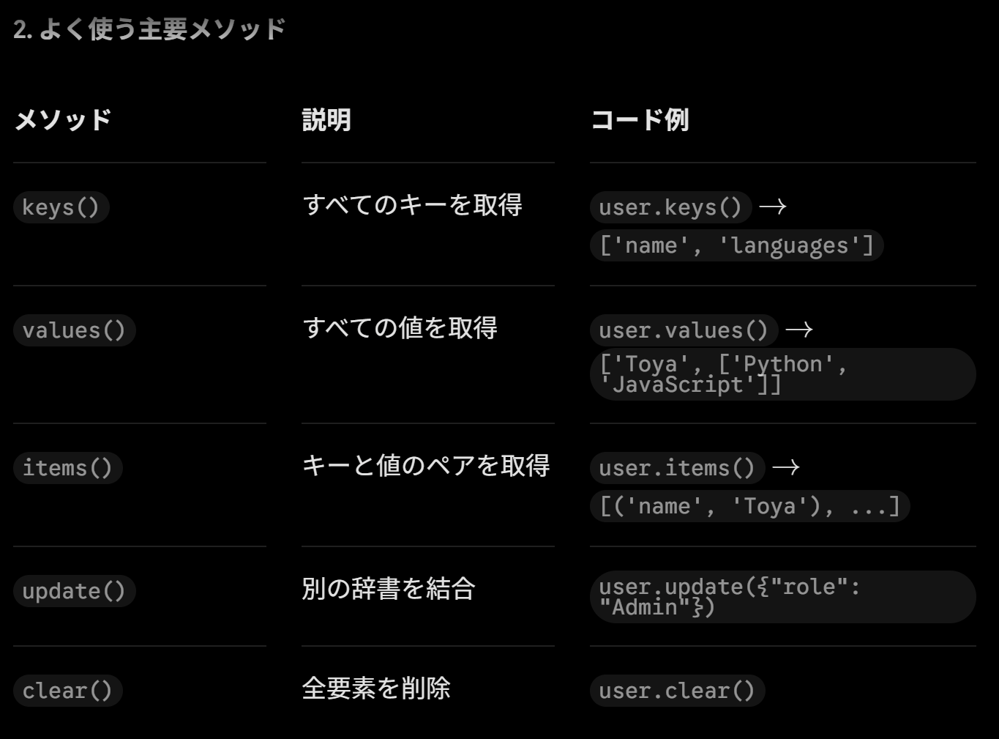
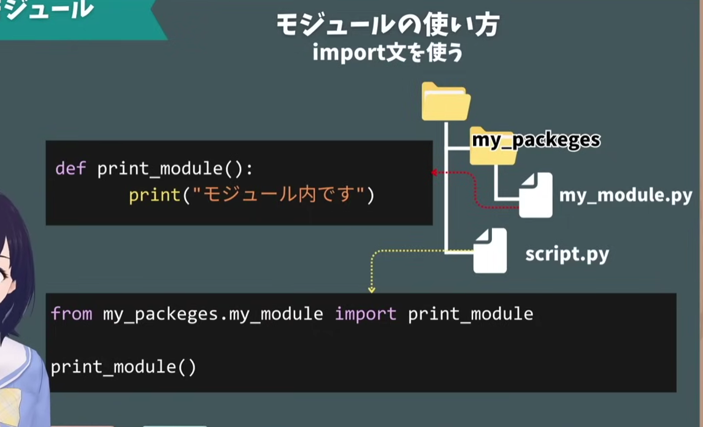

link: https://youtu.be/tCMl1AWfhQQ?si=TDyVOpPdvOTWwNf4 (【Python入門】プログラミングの基本を2時間半で学ぶ！〜初心者用チュートリアル〜 Python速習)

# Python

## List
[開始位置：終了位置]

## dict
Pythonの辞書型（dict）は、「キー（Key）と値（Value）」をペアにしてデータを管理するデータ構造です。

## Set and tuple

### 集合（set）の特徴
重複を許さない（ユニークな値のみ保持）

順序がないため、添字（インデックス）指定アクセスは不可

要素の追加（add）や削除（discard）が可能

### タプル（tuple）の特徴

変更不可能（Immutable）（間違えて書き換えるリスクを防止できる）

順序があるため、インデックスを使って値を取り出せる

同じ値を何個でも含めることができる

## loop
1. キーと値を同時に取得する (.items())
my_dict = {"apple": 1, "banana": 2, "cherry": 3}

for key, value in my_dict.items():
    print(f"Key: {key}, Value: {value}")

2. インデックス（番号）も一緒に取得する (enumerate)
何番目の要素かというカウンターが必要な場合は enumerate() を組み合わせます。

## range
range(stop) は、0 から stop - 1 までの連続した整数を生成します。

1. 基本的な使い方
0から4まで（0, 1, 2, 3, 4）を出力
for i in range(5):
    print(i)

2. 開始値と終了値を指定する (start, stop)
range(start, stop) を使うと、指定した開始値から終了値の直前までを生成できます。
2から6の直前まで（2, 3, 4, 5）を出力
for i in range(2, 6):
    print(i)

3. ステップ（増減値）を指定する (start, stop, step)
第3引数にステップを指定すると、数値をいくつずつ増減させるかを決められます。

1から10未満まで、2つ飛ばしで増加（1, 3, 5, 7, 9）
for i in range(1, 10, 2):
    print(i)

逆順（カウントダウン）: 5から0まで、1ずつ減らす（5, 4, 3, 2, 1, 0）
for i in range(5, -1, -1):
    print(i)

4. リストやタプルに変換する
range() はそのままではイテレータ（範囲オブジェクト）を返すため、リストとして中身を確認したい場合は list() で変換します。

numbers = list(range(1, 6))
print(numbers)  # 出力: [1, 2, 3, 4, 5]

## continue
Q.continueのときの処理のインデントって変えないの？

変えません！continue のあとの処理（画像では print(f"{n}: 後処理")）は、インデントを深くせず、if 文と同じ階層（または if 文の条件に一致しなかったときだけ実行される処理）としてそのまま続けます。

for n in numbers:
    print(f"{n}: 前処理")
    
    if n % 2 == 0:
        continue  # 条件に合えばここでスキップして次のループへ
        
    # ここから下は「ifの条件に一致しなかったとき」だけ実行される
    print(f"{n}: 後処理")

## def
引数のデフォルト値（初期値）
引数にあらかじめデフォルトの値を設定しておくと、呼び出し時にその引数を省略できるようになります。

def greet(name="ゲスト"):
    print(f"こんにちは、{name}さん！")

greet()  # 出力: こんにちは、ゲストさん！ （引数を省略）
greet("次郎")  # 出力: こんにちは、次郎さん！

## module
モジュールの主なメリット
コードの再利用性
一度書いた便利な関数やクラスを、別のプログラムファイルから何度でも呼び出して使うことができます。

保守性の向上（整理整頓）
何千行もあるコードを1つのファイルにすべて書くのではなく、機能ごとにファイル（モジュール）を分けることで、どこに何が書いてあるか分かりやすくなり、バグの発見や修正が簡単になります。

名前空間の分離
ファイルごとに独立した空間（名前空間）を持つため、違うファイルの間であれば、同じ名前の変数や関数があっても名前がぶつかって競合するのを防げます。

Pythonにおけるモジュールの種類
自作モジュール: 自分で作った .py ファイル（先ほどの comodity_model など）

標準ライブラリ（標準モジュール）: Pythonをインストールした段階ですでに用意されている便利なモジュール（例: 日付を扱う datetime や、ランダムな数値を扱う random など）

サードパーティ製モジュール: 他の人が作って公開してくれたモジュール（pip コマンドでインストールするもの。例: データ分析の pandas や、Web開発の requests など）

*違うフォルダにあるファイルをimportする場合

